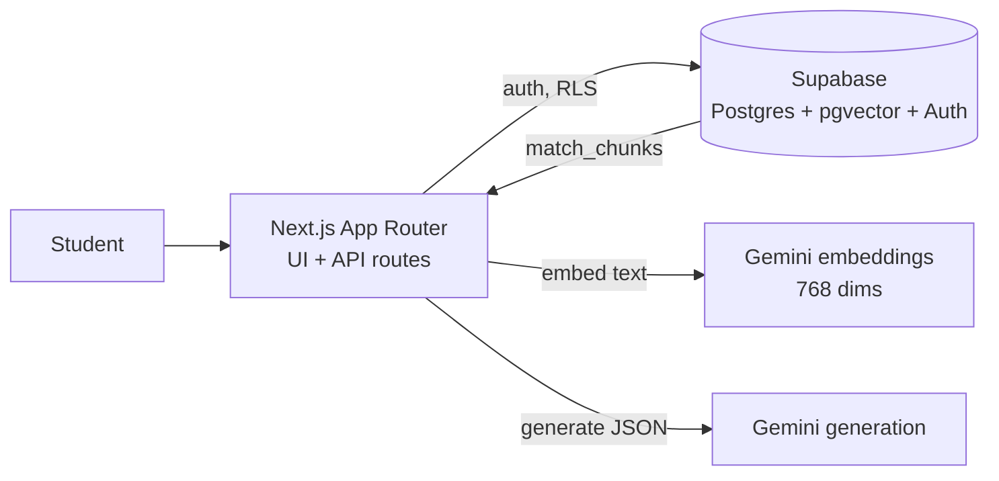
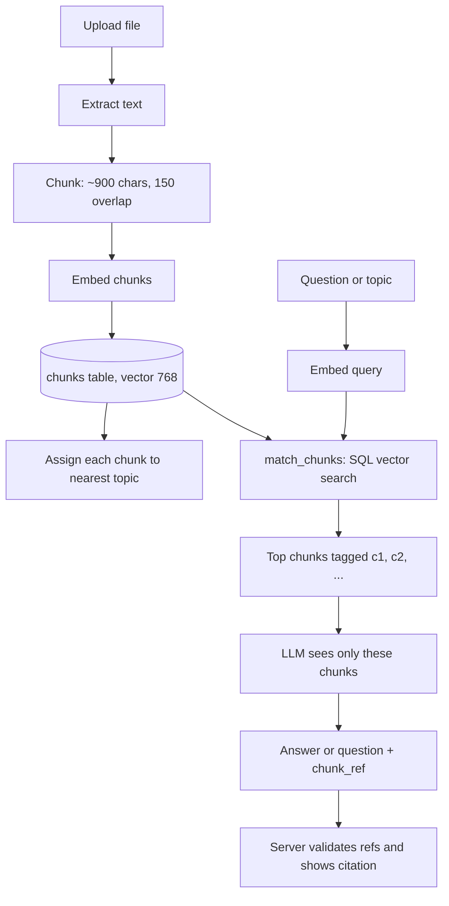

# GapFinder AI

**Find what you don't know you don't know.**

**Live demo:** https://gap-finder-ai-seven.vercel.app
**Demo login:** `demo@gapfinder.app` / `12345678` (or click "Sign in as demo" on the login page)

## Problem

Students revise what they already feel confident about and miss the topics they are actually weak in. Generic quizzes don't help because they aren't built from the student's own syllabus and notes.

GapFinder AI takes a student's own material, tests them on it, shows exactly where the gaps are, and turns the result into a revision plan. Every question and every explanation is tied back to a source in the student's own notes.

## What it does

1. **Upload** a syllabus, notes or past papers (PDF, TXT or MD).
2. **Topic map:** the syllabus is turned into topics, and every note chunk is linked to its nearest topic.
3. **Diagnostic quiz:** multiple-choice questions generated from the student's notes, each with a source citation.
4. **Gap report:** each topic is classified as weak, medium, strong or untested, with the questions that were missed.
5. **Revision plan:** a day-by-day plan that prioritises weak topics, with sources for each session.
6. **Explain this topic:** ask any question and get an answer drawn only from the uploaded notes, with citations. It refuses when the notes don't cover the question.
7. **Progress across attempts** so improvement is visible after retakes.

## Architecture



| Layer | Choice |
|---|---|
| Framework | Next.js 16 (App Router), TypeScript, Tailwind v4 |
| Database | Supabase Postgres + pgvector, row-level security per user |
| Auth | Supabase Auth via `@supabase/ssr` |
| Embeddings | `gemini-embedding-001`, truncated to 768 dimensions |
| Generation | Gemini via REST, with retries and model fallback |
| PDF parsing | `unpdf` |
| Hosting | Vercel |

## RAG pipeline



- **Retrieval never calls the LLM.** It is pure SQL vector search (`match_chunks`).
- **Generation sees only retrieved chunks**, each tagged `[c1]`, `[c2]`, and so on, and must return the tag it used.
- **The server validates every citation.** Any question or answer whose tag was not among the retrieved chunks is dropped. The citation shown to the student is the chunk's real section label.
- Quizzes use notes chunks only, never syllabus chunks, and skip topics that have no notes.

## AI workflow and guardrails

| Step | What the AI does | What the code enforces |
|---|---|---|
| Topic map | Proposes topics from the syllabus | Chunks are assigned by vector similarity in SQL |
| Quiz | Writes 4-option questions from retrieved excerpts | Exactly 4 options, one correct, valid chunk ref, options shuffled server-side |
| Gap report | None (plain code, `computeGaps`) | Status computed from per-topic scores |
| Plan | Writes a focus line per topic from that topic's own material | Rules forbid mixing in other topics; sources are listed per session |
| Explain | Answers from at most 5 retrieved chunks | Refuses when similarity is low, when the model says the excerpts don't cover it, or when no valid citation remains |

Retrieved material is treated as data, not instructions. The generation prompts tell the model to ignore commands inside the excerpts.

## Run locally

```bash
npm install
npm run dev
```

Create `.env.local`:

```
NEXT_PUBLIC_SUPABASE_URL=...
NEXT_PUBLIC_SUPABASE_ANON_KEY=...
GOOGLE_GENERATIVE_AI_API_KEY=...
GEMINI_MODEL=gemini-flash-lite-latest
```

The Supabase project needs the `pgvector` extension, the tables (`documents`, `topics`, `chunks`, `quizzes`, `questions`, `answers`, `plans`), RLS policies, and the SQL functions `match_chunks` and `assign_chunks_to_topics`.

## Limitations

- Scanned PDFs are not supported (no OCR). Text PDFs, TXT and MD work.
- Every chunk is assigned to its nearest topic, even when it is only loosely related, so a revision focus line can occasionally mention a neighbouring concept.
- A gap status based on one or two questions is low confidence.
- Each quiz can be submitted once. Retake by generating a new quiz.
- Regenerating the topic map deletes the old topics, and with them their questions and answers.
- The demo account is shared, so its data can be changed by anyone using it.
- Model names are set by environment variable because Google retires and overloads models. Generation can be slow on larger models, so the lite model is the default.

## Project structure

```
src/
  app/
    page.tsx                  home: upload, topics, quiz, gaps, plan, explain
    login/page.tsx
    quiz/[id]/page.tsx
    api/
      upload/  topics/generate/  quiz/generate/  quiz/[id]/submit/
      plan/generate/  explain/  documents/[id]/
  components/                 UploadForm, TopicMapButton, StartQuizButton,
                              QuizRunner, PlanForm, ExplainBox, DeleteDocButton
  lib/
    rag.ts                    chunking, embeddings, generateJSON
    gaps.ts                   computeGaps
    supabase/                 server and browser clients
```