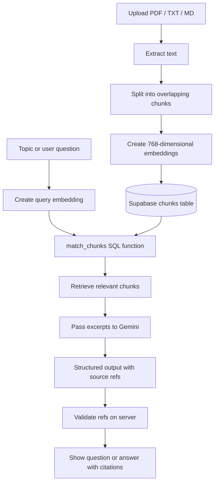
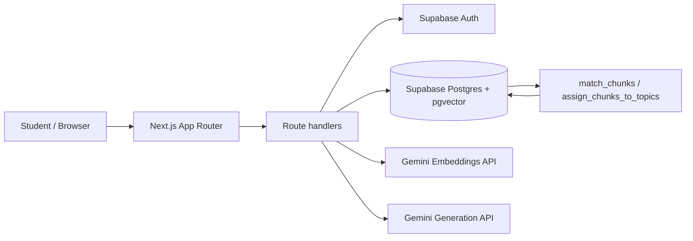

# GapFinder AI

**Find what you don't know you don't know.**

GapFinder AI is an AI-assisted study companion that identifies learning gaps using a student's own syllabus and study material. Instead of offering a generic quiz, it builds a topic map, generates source-grounded diagnostic questions, summarizes topic-level performance, and turns the results into a focused revision plan.

<p align="center">
  <a href="https://gap-finder-ai-seven.vercel.app"><strong>Open the live demo →</strong></a>
</p>

> **Demo account:** `demo@gapfinder.app`  
> Use the **Sign in as demo** option on the login screen where available. The demo account is shared; avoid uploading private or sensitive documents.

## Contents

- [Why GapFinder AI?](#why-gapfinder-ai)
- [Features](#features)
- [How it works](#how-it-works)
- [System architecture](#system-architecture)
- [Technology stack](#technology-stack)
- [Getting started](#getting-started)
- [Environment variables](#environment-variables)
- [Supabase setup](#supabase-setup)
- [Project structure](#project-structure)
- [API routes](#api-routes)
- [AI grounding and safeguards](#ai-grounding-and-safeguards)
- [Limitations](#limitations)
- [Troubleshooting](#troubleshooting)
- [Roadmap](#roadmap)

## Why GapFinder AI?

Students often spend time revising familiar concepts while overlooking weak or untested areas. Generic quizzes may also cover material that is not part of a student's syllabus.

GapFinder AI follows a source-first workflow:

1. Upload your own syllabus and notes.
2. Turn the syllabus into a structured topic map.
3. Generate diagnostic questions from relevant note excerpts.
4. Review topic-level performance and the questions answered incorrectly.
5. Build a revision plan that gives more attention to weaker topics.
6. Ask questions about your material and review the source excerpts behind answers.
7. Retake a focused quiz on weak or medium topics and compare attempt scores.

## Features

### Personalised material ingestion
- Accepts PDF, TXT, and Markdown/text files.
- Lets the user classify uploads as a **syllabus**, **notes**, or **past paper**.
- Extracts text, splits it into overlapping chunks, and creates vector embeddings for retrieval.
- Keeps a source label for each chunk so the app can display a citation such as a document name, part, or PDF page.

### Syllabus-driven topic map
- Extracts distinct topics from the uploaded syllabus.
- Embeds topics and associates stored chunks with the nearest topic using the database assignment function.
- Uses the topic map as the basis for quizzes, gap analysis, and revision planning.

### Source-grounded diagnostic quiz
- Generates multiple-choice questions from retrieved note chunks rather than relying on generic question banks.
- Uses four answer options per valid generated question.
- Stores a reference to the source chunk and displays its source label.
- Shuffles answer-option order before storing a question.
- Supports submitting an attempt and reviewing correctness, explanations, and source citations.

### Topic-level gap report
The app classifies each topic using the latest attempt that contains questions for that topic:

| Status | Rule |
|---|---|
| **Strong** | At least 80% correct |
| **Medium** | At least 50% but below 80% correct |
| **Weak** | Below 50% correct |
| **Untested** | No answered questions for that topic in the available attempts |

These labels are a study aid, not a formal measurement of mastery. Results based on very few questions should be treated cautiously.

### Personalised revision plan
- Creates a day-by-day plan based on available quiz results.
- Allocates more study weight to weak and untested topics than to strong topics.
- Uses topic-linked study material and missed questions to generate practical focus actions.
- Supports a target number of study hours per day and an optional exam date.

### Explain this topic
- Retrieves relevant excerpts from uploaded material.
- Generates an explanation using retrieved excerpts only.
- Displays citations for supported claims.
- Refuses to answer when the retrieved material does not adequately support an answer.

### Focused retakes and progress
- Builds a follow-up quiz from weak and medium topics.
- Produces questions iteratively, tracks the retake's progress, and avoids reusing already-used chunks when alternatives are available.
- Shows quiz-attempt scores in a progress chart.

### Account and document controls
- Uses Supabase authentication.
- Uses user-scoped database policies for data isolation.
- Provides a document-delete endpoint for removing an uploaded document and its dependent records according to database relationships.

## How it works

### Typical student workflow

1. **Sign in.** Open the live demo or run the app locally.
2. **Upload syllabus.** Choose the syllabus document type and upload a text-based PDF, TXT, or MD file.
3. **Generate the topic map.** Review the topics extracted from the syllabus.
4. **Upload notes.** Add class notes or study material that supports the topics. Past papers may also be uploaded as a reference document.
5. **Generate a diagnostic quiz.** The app retrieves note chunks relevant to the topics and asks the generation model to create questions grounded in those excerpts.
6. **Submit answers.** See correctness, explanations, and source labels.
7. **Review your gaps.** Find weak, medium, strong, and untested topics.
8. **Create a revision plan.** Enter your available study time and, optionally, your exam date.
9. **Study and retake.** Use Explain This Topic, take a focused retake, and compare progress.

### Retrieval-Augmented Generation (RAG)

The app uses a retrieval-augmented generation pattern so that generation is conditioned on the user's indexed study material.



The main steps are:

1. **Parse:** extract text from the uploaded document. PDF pages are retained as source metadata where available.
2. **Chunk:** split text into manageable sections (the current chunking helper targets approximately 900 characters with 150 characters of overlap).
3. **Embed:** use Google's `gemini-embedding-001` embedding model and request 768 dimensions.
4. **Store:** persist text chunks and embeddings in Supabase Postgres using pgvector.
5. **Retrieve:** embed a topic or query and call the SQL `match_chunks` function for similarity-based retrieval.
6. **Generate:** pass the retrieved excerpts to Gemini and request structured JSON.
7. **Validate:** validate source references against the retrieved set before showing generated quiz questions or cited explanations.

Retrieval itself is performed by the database search function; the language model does not select database rows directly. The Explain endpoint also applies a similarity/coverage gate before generation and requires at least one validated citation to return an answer.

## System architecture



| Layer | Technology | Responsibility |
|---|---|---|
| Web application | Next.js App Router, React, TypeScript | Pages, UI, server route handlers |
| Styling | Tailwind CSS v4 | Responsive application styling |
| Authentication | Supabase Auth, `@supabase/ssr` | Session-aware authentication |
| Database | Supabase Postgres | Store users' documents, topics, quizzes, answers, and plans |
| Vector retrieval | pgvector and SQL RPCs | Similarity search over embedded text chunks |
| Embeddings | Google Gemini `gemini-embedding-001` | Convert chunks and queries to vectors |
| Generation | Google Gemini REST API | Generate structured topics, questions, explanations, and study focus |
| PDF text extraction | `unpdf` | Read text and page-separated content from PDFs |
| Hosting | Vercel | Hosted web application |

## Technology stack

- **Language:** TypeScript
- **Framework:** Next.js 16 App Router
- **Frontend:** React 19, Tailwind CSS v4
- **Backend:** Next.js Route Handlers
- **Authentication and database:** Supabase
- **Vector database extension:** pgvector
- **AI:** Gemini embeddings and generation APIs
- **Validation / structured output dependencies:** Zod and the AI SDK packages are included in project dependencies
- **PDF extraction:** unpdf
- **Package manager:** npm (lockfile: `package-lock.json`)

## Getting started

### Prerequisites

Install the following before running locally:

- Node.js compatible with the installed Next.js version
- npm
- A Supabase project
- A Google AI API key with access to the configured Gemini embedding and generation models

### 1. Clone the repository

```bash
git clone https://github.com/Dishagupta275/GapFinder_AI.git
cd GapFinder_AI
```

### 2. Install dependencies

```bash
npm install
```

### 3. Configure environment variables

Create a file named `.env.local` in the repository root. Use the variable names listed in the next section. Do not commit this file or paste private API keys into issues, chats, screenshots, or source code.

### 4. Configure Supabase

Create/configure the database objects listed in [Supabase setup](#supabase-setup). The repository currently documents the required tables and SQL function names, but does not include a committed SQL migration file. If you are setting up a new project, use the database definition maintained for your own deployment and verify that policies, indexes, constraints, and RPC signatures match the application code.

### 5. Start the development server

```bash
npm run dev
```

Open [http://localhost:3000](http://localhost:3000).

### 6. Run quality checks

```bash
npm run lint
npm run build
```

Run these checks before deploying changes. A successful local development server alone does not guarantee that the production build passes.

## Environment variables

| Variable | Required | Purpose |
|---|---|---|
| `NEXT_PUBLIC_SUPABASE_URL` | Yes | URL of your Supabase project |
| `NEXT_PUBLIC_SUPABASE_ANON_KEY` | Yes | Supabase publishable/anon key used by the client configuration |
| `GOOGLE_GENERATIVE_AI_API_KEY` | Yes | Server-side key used for embeddings and generation calls |
| `GEMINI_MODEL` | Recommended | Generation model name; defaults to `gemini-flash-latest` in the code |

Example `.env.local` (replace every placeholder with your own values):

```dotenv
NEXT_PUBLIC_SUPABASE_URL=https://YOUR_PROJECT.supabase.co
NEXT_PUBLIC_SUPABASE_ANON_KEY=YOUR_SUPABASE_PUBLISHABLE_KEY
GOOGLE_GENERATIVE_AI_API_KEY=YOUR_GOOGLE_AI_API_KEY
GEMINI_MODEL=gemini-flash-lite-latest
```

**Secret handling**
- Keep `GOOGLE_GENERATIVE_AI_API_KEY` server-side and out of client components.
- Never put a Supabase service-role key in a `NEXT_PUBLIC_*` variable.
- Do not commit `.env.local`; verify that it is ignored by Git.
- Rotate a key immediately if it is accidentally exposed in a public commit.

The generation model can be overridden because model availability, names, and quotas can change. Choose a model that is currently enabled for your Google AI project.

## Supabase setup

The application expects a Supabase project configured with:

### Required tables

| Table | Purpose |
|---|---|
| `documents` | Uploaded document metadata and type |
| `topics` | Syllabus-derived topics and topic embeddings |
| `chunks` | Extracted document sections, source labels, embeddings, and topic association |
| `quizzes` | Diagnostic and retake quiz attempts |
| `questions` | Generated question, options, correct option, explanation, topic, and source chunk |
| `answers` | User-selected option and correctness for submitted questions |
| `plans` | Generated revision-plan data |

### Required database capabilities

- Enable the `vector` extension (pgvector).
- Store chunk and topic embeddings in compatible vector columns; the embedding endpoint is configured for **768 dimensions**.
- Create row-level security (RLS) policies that isolate each user's records.
- Provide the SQL RPC function `match_chunks` with the arguments used by the route handlers, including `query_embedding`, `match_count`, and `filter_topic`.
- Provide `assign_chunks_to_topics` to associate chunks with the nearest topic.
- Configure foreign keys and delete behavior consistently with the app's document, topic, quiz, question, answer, and plan relationships.
- Ensure indexes and constraints required by the query patterns are present.

**Important:** no SQL setup script is currently present in the repository tree. Do not assume a clean Supabase project can be initialized from this repository alone without obtaining the matching schema and RLS definitions.

## Project structure

```text
GapFinder_AI/
├── public/                         # Static assets
├── src/
│   ├── app/
│   │   ├── api/
│   │   │   ├── upload/             # Document parsing, chunking, embedding, storage
│   │   │   ├── topics/generate/     # Topic extraction from syllabus
│   │   │   ├── quiz/generate/       # Source-grounded diagnostic quiz generation
│   │   │   ├── quiz/[id]/submit/   # Grade and store quiz responses
│   │   │   ├── retake/start/       # Find weak/medium topics for retaking
│   │   │   ├── retake/next/        # Generate/serve the next retake question
│   │   │   ├── retake/answer/      # Record a retake answer
│   │   │   ├── plan/generate/      # Generate a revision schedule
│   │   │   ├── explain/            # Citation-grounded Q&A over notes
│   │   │   └── documents/[id]/     # Delete an owned document
│   │   ├── login/                  # Login screen
│   │   ├── quiz/[id]/              # Quiz page
│   │   ├── retake/[id]/            # Focused retake page
│   │   ├── page.tsx                # Main dashboard
│   │   ├── layout.tsx              # Root layout and metadata
│   │   └── loading.tsx             # Dashboard loading state
│   ├── components/
│   │   ├── UploadForm.tsx
│   │   ├── TopicMapButton.tsx
│   │   ├── StartQuizButton.tsx
│   │   ├── QuizRunner.tsx
│   │   ├── RetakeRunner.tsx
│   │   ├── PlanForm.tsx
│   │   ├── ExplainBox.tsx
│   │   ├── ProgressChart.tsx
│   │   └── DeleteDocButton.tsx
│   ├── lib/
│   │   ├── rag.ts                  # Chunking, embeddings, Gemini JSON generation
│   │   ├── gaps.ts                 # Deterministic topic gap / attempt calculations
│   │   └── supabase/               # Browser and server Supabase clients
│   └── middleware.ts               # Session refresh / route protection
├── package.json
├── package-lock.json
├── next.config.ts
├── tsconfig.json
└── README.md
```

## API routes

All routes below require an authenticated Supabase user unless stated otherwise. The route handlers are internal application endpoints, not a separately versioned public API.

| Method | Endpoint | Purpose |
|---|---|---|
| `POST` | `/api/upload` | Upload a syllabus, notes, or past paper; extract text, chunk, embed, and store it |
| `POST` | `/api/topics/generate` | Generate topics from uploaded syllabus material |
| `POST` | `/api/quiz/generate` | Generate a quiz; accepts optional `{"weakOnly": true}` for weak/medium topics |
| `POST` | `/api/quiz/:id/submit` | Submit answers and return correctness, explanation, and citations |
| `POST` | `/api/retake/start` | Start a focused retake using current weak/medium topics |
| `POST` | `/api/retake/next` | Resume or generate the next question for a retake |
| `POST` | `/api/retake/answer` | Submit an answer to the current retake question |
| `POST` | `/api/plan/generate` | Generate a revision plan from gap results and study-time settings |
| `POST` | `/api/explain` | Answer a question from retrieved study material, with validated citations |
| `DELETE` | `/api/documents/:id` | Delete an owned document |

## AI grounding and safeguards

The project is designed to reduce unsupported AI output, not to guarantee that every generated sentence is correct.

- **Scoped inputs:** quiz and Explain generation receive retrieved content from the user's stored material.
- **Structured output:** generation requests JSON conforming to an expected schema.
- **Citation references:** retrieved passages are tagged with temporary chunk references (for example, `c1`).
- **Server-side validation:** question/source references are checked against the retrieved chunks; invalid generated questions are discarded.
- **Answer explanations:** explanations are generated alongside questions and shown after submission.
- **Refusal behavior:** Explain can refuse when retrieved evidence is weak or does not support an answer.
- **Prompt-injection handling:** retrieved document content is treated as data, not as instructions to the AI model.
- **Deterministic scoring:** gap classification and quiz correctness calculations are performed by application code, rather than asking the model to decide whether the student was correct.

### Practical caveats

Citation validation proves that a returned citation refers to a chunk supplied to the model; it does not independently prove the claim is entailed by that chunk. AI-generated questions, explanations, topic labels, and revision actions should still be reviewed by the student. Similarity search can retrieve related but incomplete content.

## Limitations

- **Scanned PDFs:** OCR is not implemented. PDFs must contain selectable text; scanned image-only PDFs will not produce usable text.
- **Upload size:** the current upload endpoint rejects files larger than 10 MB.
- **Chunk/topic matching:** each chunk is assigned to its nearest topic. There is no minimum similarity cutoff for that assignment, so some chunks may be loosely related to their topic.
- **Small diagnostic samples:** topic status is unreliable when a topic has only one or two answered questions.
- **Topic-map regeneration:** regenerating the map replaces existing topics and can affect data related to those topics. Back up important data before doing this.
- **Model availability and quotas:** generation can fail due to an unsupported model, rate limits, or provider overload.
- **Latency:** upload embedding and generation can take time, and serverless cold starts may add delay.
- **Demo privacy:** the demo account is shared and its contents may be altered or deleted by other visitors. Do not upload confidential material.
- **Database setup:** schema, RLS policies, indexes, and SQL function definitions are not included as a checked-in migration yet.

## Troubleshooting

| Symptom | What to check |
|---|---|
| Login fails | Confirm the Supabase URL/key, Auth user configuration, and redirect/session setup |
| `Unauthorized` from an API | Sign in again and confirm the browser session is available to the server |
| Upload says no text was found | Check whether the PDF contains selectable text; scanned PDFs need OCR before use |
| Embedding request fails | Verify `GOOGLE_GENERATIVE_AI_API_KEY`, provider quota, network access, and embedding-model availability |
| Generation returns 404 | Check that `GEMINI_MODEL` names a model enabled for the API key |
| Generation returns 429 or 503 | Check quota/provider capacity and retry later; fallback models may also be rate-limited |
| Topic map is empty | Upload a readable syllabus before generating the map |
| Quiz has no questions for a topic | Upload notes covering that topic and regenerate the quiz |
| Explain declines to answer | Ensure the question is covered by uploaded notes and that the relevant notes were successfully indexed |
| Database reports missing function/table | Compare your Supabase schema, RPC signatures, RLS rules, and vector dimensions with the application's expectations |

### Useful local commands

```bash
npm run dev     # Start the local development server
npm run lint    # Run ESLint
npm run build   # Validate the production build
npm run start   # Serve the production build (after npm run build)
```

## Roadmap

Potential next steps include:

- Add a checked-in, versioned Supabase migration and test seed data.
- Add integration tests for upload, retrieval, grading, gap classification, and retake flows.
- Evaluate retrieval quality using known questions and expected source chunks.
- Apply a similarity cutoff when assigning chunks to topics.
- Add OCR support for scanned PDFs.
- Improve chunking with heading-aware boundaries and optional reranking.
- Add spaced-repetition reminders and class-level analytics.
- Expand language and subject support.

## Contributing

Contributions and practical bug reports are welcome.

1. Fork the repository and create a feature branch.
2. Keep changes focused and avoid committing secrets or private student documents.
3. Run `npm run lint` and `npm run build`.
4. Describe the change, how to test it, and any environment or database changes in your pull request.

## License

No license file is currently included. Unless a license is added to the repository, all rights remain with the copyright holder and reuse permissions are not explicitly granted.
