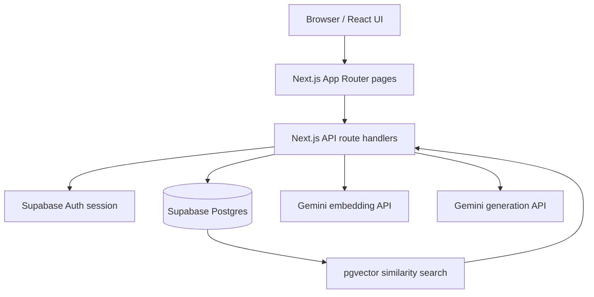
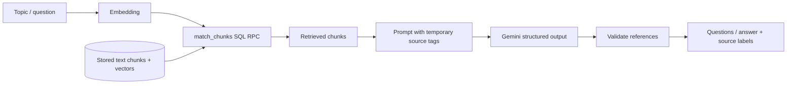

# GapFinder AI — Architecture

This document describes the current implementation in the repository. It is intended for developers who want to understand the request flow, retrieval design, data model, and key trade-offs before modifying the application.

## 1. High-level design

GapFinder AI is a Next.js application with server-side route handlers. Supabase provides authentication and persistence. Google Gemini is used for embeddings and structured text generation.

### Main code boundaries

| Location | Responsibility |
|---|---|
| `src/app/page.tsx` | Main dashboard and entry point to the study workflow |
| `src/app/login/page.tsx` | Login UI |
| `src/app/quiz/[id]/page.tsx` | Diagnostic quiz page |
| `src/app/retake/[id]/page.tsx` | Focused retake page |
| `src/app/api/**/route.ts` | Server-side request validation, database access, AI calls, and responses |
| `src/components/` | Client-side UI for upload, topic generation, quizzes, plans, explanations, retakes, and progress |
| `src/lib/rag.ts` | Text chunking, embedding requests, and JSON-constrained Gemini generation |
| `src/lib/gaps.ts` | Deterministic quiz-attempt and topic-gap calculations |
| `src/lib/supabase/server.ts` | Server Supabase client with request session handling |
| `src/lib/supabase/client.ts` | Browser Supabase client |
| `src/middleware.ts` | Session refresh and route handling |

## 2. Document ingestion

The upload endpoint is `POST /api/upload`.

1. The server obtains the signed-in user from Supabase Auth. Requests without a user are rejected.
2. It reads the multipart form fields: `file`, `kind` and optional `title`.
3. The accepted document kinds are `syllabus`, `notes`, and `past_paper`. Files above 10 MB are rejected.
4. PDF files are parsed with `unpdf` in page-separated mode. Non-PDF files are read as text.
5. `chunkText` normalizes whitespace and creates overlapping text chunks. Its default target is about 900 characters with a 150-character overlap; long pieces are hard-split.
6. Each chunk retains a source label, such as a PDF page label or text-part label.
7. `embedTexts` calls the Gemini embedding endpoint in batches of up to 100 texts, requesting 768-dimensional vectors.
8. The server creates document metadata and inserts chunk rows in batches of 50.
9. It calls `assign_chunks_to_topics` so the database can associate chunks with existing topics.

If chunk insertion or embedding fails after document metadata is created, the handler attempts to delete that document record to avoid leaving an apparently successful upload. The upload endpoint returns the new document identifier and chunk count.

**Current boundary:** scanned/image-only PDFs do not produce extractable text because OCR is not implemented. The endpoint supports files up to 10 MB.

## 3. Topic map generation

The topic endpoint is `POST /api/topics/generate`.

1. The handler loads syllabus chunks from the database and joins their text. The prompt input is capped at 30,000 characters.
2. Gemini is asked to extract distinct topics from the syllabus only.
3. The response is normalized, duplicate topic names are removed, and the topic list is bounded.
4. Each topic name and description is embedded using the retrieval-query task type.
5. Existing topic rows for the user are deleted and the newly generated topic rows are inserted.
6. The handler calls `assign_chunks_to_topics` again so existing chunks can be linked to the new topic set.

Regenerating a topic map is a destructive operation for topic-linked data, depending on configured database foreign keys and delete policies. Treat this as a re-indexing operation and avoid doing it casually when the account contains quiz history you need to preserve.

## 4. Retrieval-augmented generation (RAG)

The app uses vector similarity search to select study material before asking the model to generate a question or explanation.

### Embeddings and retrieval

- Embeddings are requested from `gemini-embedding-001` with an output dimensionality of 768.
- The database function `match_chunks` performs similarity search. Route handlers pass a query vector, result count, and (where applicable) topic filter.
- The model receives the retrieved content only, tagged with temporary references such as `[c1]` and `[c2]`.
- A generated quiz question must identify a valid retrieved chunk reference. The handler resolves that reference to a stored chunk ID and discards invalid questions.
- Source labels are stored separately from temporary model tags. The user sees the source label (document/part/page), not a model-invented source path.

### Why validate source references?

Models can output a reference that was not present in the prompt. Before persisting a generated question or displaying a cited answer, the application checks references against the set of chunks retrieved for that request. This prevents a model from inventing an arbitrary chunk identifier.

This validation confirms **reference provenance**, not full semantic entailment: it does not mathematically prove that every claim is supported by the cited text. AI-generated learning content should still be reviewed.

## 5. Diagnostic quiz flow

The main quiz generation endpoint is `POST /api/quiz/generate`.

1. The handler loads the user's topic map.
2. It embeds topic names and descriptions and retrieves relevant chunks with `match_chunks`.
3. Syllabus chunks are excluded from the quiz source set. Topics without note material are skipped.
4. Gemini is instructed to generate multiple-choice questions from the supplied excerpts, with four options, one correct answer, and an explanation.
5. The handler checks the question fields, option count, correct-option index, and source reference.
6. The answer-option order is shuffled server-side and the stored correct index is adjusted to match.
7. The quiz and its questions are saved to Supabase.

The quiz submission endpoint is `POST /api/quiz/:id/submit`. It compares submitted selections to stored correct-option indexes and records correctness in the answers table. The handler rejects empty answer lists and attempts to submit a quiz that already has answers.

## 6. Gap calculation

Gap classification is implemented in `src/lib/gaps.ts` and does not require a language-model call.

For each topic, the implementation searches quiz attempts from newest to oldest and uses the most recent attempt that contains answered questions for that topic. It computes:

`topic accuracy = number correct / number answered`

| Topic accuracy | Label |
|---|---|
| `>= 0.80` | `strong` |
| `>= 0.50` and `< 0.80` | `medium` |
| `< 0.50` | `weak` |
| No answered questions for the topic | `untested` |

The report also collects the questions missed in the selected attempt. A small sample makes the status uncertain; the UI/code notes that a topic represented by only one question has low confidence.

## 7. Revision plan

The plan endpoint is `POST /api/plan/generate`.

- A diagnostic attempt must exist before a plan can be generated.
- Study hours per day are bounded between 0.5 and 12.
- The schedule defaults to seven days. An optional exam date adjusts the number of days, bounded between one and fourteen.
- Time allocation uses weights of 3 for weak, 2 for medium, 2 for untested, and 0.5 for strong topics.
- The model receives each topic's status, missed questions, and topic-linked material and is asked to return a short focus plan for that topic.

The allocation weights are heuristics rather than an estimate of the exact time a student will need. Review the plan and adjust it to your course requirements.

## 8. Explain-this-topic flow

The endpoint is `POST /api/explain`.

1. The server validates the question and retrieves likely relevant chunks.
2. A similarity/coverage gate can stop the request when the retrieved evidence appears insufficient.
3. At most five selected chunks are provided to Gemini with instructions to answer only from those excerpts.
4. The model returns a structured response that indicates whether the excerpts are sufficient and lists source references.
5. The server removes unrecognized source tags and returns a refusal when the response is not answerable, has no answer, or has no valid citation.
6. Supported answers include source labels and short snippets.

A refusal means the system did not find enough support in the indexed material; it does not necessarily mean the question has no answer elsewhere.

## 9. Focused retakes and progress

The retake flow is implemented through:

- `POST /api/retake/start`: selects topics currently classified as weak or medium and creates a quiz record.
- `POST /api/retake/next`: resumes an unanswered question when one exists, otherwise retrieves a note chunk and generates the next question. The current implementation targets three questions per selected topic and tries to avoid previously used chunks when fresh alternatives exist.
- `POST /api/retake/answer`: records the answer to the active question.

The progress chart uses recorded quiz attempts. Since the gap report uses the most recent attempt containing data for each topic, the displayed topic status and the overall attempt-score history answer different questions.

## 10. Data model at a glance

The application expects these tables. This is a **logical overview**, not a replacement for the actual database DDL.

| Table | Main role | Key relationships/fields used by the app |
|---|---|---|
| `documents` | Uploaded file metadata | User ID, kind, title, document ID |
| `chunks` | Extracted text and vectors | User ID, document ID, content, page, section label, embedding, topic association |
| `topics` | Syllabus-derived study topics | User ID, name, description, position, embedding |
| `quizzes` | Quiz/retake container | User ID, quiz ID, creation timestamp |
| `questions` | Generated quiz items | Quiz ID, topic ID, chunk ID, question, options, correct index, explanation |
| `answers` | Submitted responses | Question ID, user ID, selected index, correctness, timestamp |
| `plans` | Revision plan records | User/plan fields required by the plan handler and UI |

### Database functions

- **`match_chunks`**: performs vector similarity retrieval and accepts the arguments used by the server handlers, including query embedding, match count, and optional topic filter.
- **`assign_chunks_to_topics`**: associates chunks with the nearest topic using stored vectors.

### Schema and security are deployment responsibilities

There is currently no checked-in Supabase migration/SQL schema file in this repository. A new deployment needs the matching table definitions, vector dimensions, indexes, foreign keys, RPC definitions, and RLS policies from the configured database. Keep that schema in version control as a future improvement.

All application routes use the session-aware Supabase server client and check for an authenticated user. The actual data-isolation boundary depends on correctly configured RLS policies and foreign keys. Ensure policies prevent one account from reading, changing, or deleting another account's rows; do not treat client-side UI checks as a security boundary.

## 11. Security and trust boundaries

- **API key:** `GOOGLE_GENERATIVE_AI_API_KEY` must remain server-side.
- **Supabase:** the frontend publishable/anon key is not a substitute for RLS. Correct row-level security is required.
- **User uploads:** retrieved document text is untrusted content. Prompts direct the model to ignore instructions inside excerpts.
- **Generated content:** validate schemas and references before persistence or display, but still treat generated educational content as fallible.
- **Shared demo:** demo content is mutable and should not contain personal, confidential, or sensitive information.
- **Deletion and regeneration:** verify foreign-key cascade behavior before destructive operations against a production database.

## 12. Known technical limitations

- No OCR for scanned PDFs.
- Nearest-topic assignment has no documented minimum similarity cutoff.
- Citation validation checks reference provenance rather than full semantic entailment.
- Model names, quota, and latency depend on the provider and API project.
- The repository does not currently include a checked-in schema migration or a dedicated automated test suite.

When changing retrieval, chunking, database relationships, or gap calculation, validate the end-to-end flow rather than checking only that an endpoint returns HTTP 200.
